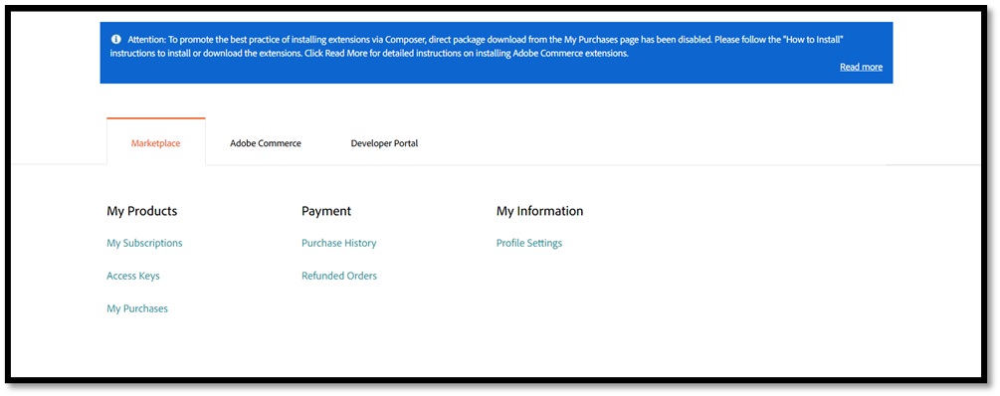
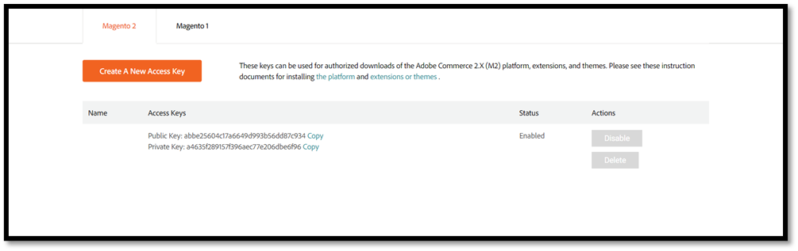
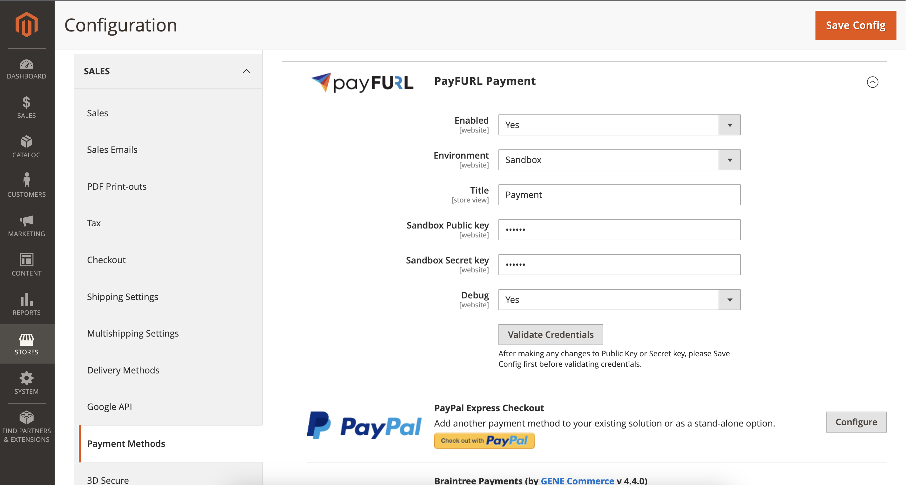

# payFURL for Magento 2

Accept payments on Magento Open Source and Adobe Commerce through [payFURL](https://payfurl.com): cards (with
saved cards), PayPal, Google Pay, Apple Pay, PayTo and checkout methods such as PayID, routed to the gateways set
up in your payFURL account.

The package is [`payfurl/module-payment`](https://packagist.org/packages/payfurl/module-payment); the Magento module
is `Payfurl_Payment`. What changed in each version is in [CHANGELOG.md](CHANGELOG.md).

## Supported versions

| Module | Magento / Adobe Commerce | PHP |
| --- | --- | --- |
| 2.x | 2.4.7, 2.4.8, 2.4.9 | 8.2 to 8.5, as your Magento version allows (2.4.7: 8.2, 8.3; 2.4.8: 8.3, 8.4; 2.4.9: 8.3 to 8.5) |
| 1.x | 2.4.6 and earlier | No longer updated |

## Install

Install on a development or staging copy of your store first, and back up the store before installing on
production (`bin/magento setup:backup --code --media --db`, or your host's backup).

```bash
bin/magento maintenance:enable
composer require payfurl/module-payment:^2.0
bin/magento setup:upgrade
bin/magento setup:di:compile
bin/magento setup:static-content:deploy -f
bin/magento cache:flush
bin/magento maintenance:disable
```

Composer installs the module from Packagist and the payFURL PHP SDK it needs. If Composer asks for
`repo.magento.com` credentials, use your Commerce Marketplace access keys: at
[marketplace.magento.com](https://marketplace.magento.com/), **My Profile > Marketplace > Access Keys**. The public
key is the username and the private key the password.




### Upgrade

```bash
composer update payfurl/module-payment
bin/magento setup:upgrade
bin/magento setup:di:compile
bin/magento setup:static-content:deploy -f
bin/magento cache:flush
```

**From 1.x to 2.0:** update Magento to 2.4.7 or later first; 2.0 doesn't install on older versions. Then
`composer require payfurl/module-payment:^2.0` and the commands above. After upgrading, set up the webhook (see
[Webhooks](#webhooks)) so payments that settle later complete their orders. If your own code used methods the 1.x
module added to Magento's payment order adapter, see the 2.0.0 entry in the [changelog](CHANGELOG.md).

## Configure

**Stores > Configuration > Sales > Payment Methods > PayFURL Payment** (under recommended solutions):



| Setting | What it does |
| --- | --- |
| Enabled | Shows the payFURL payment methods at checkout. |
| Environment | **Sandbox** for testing with your payFURL sandbox account, **Production** for real payments. |
| Title | The card payment method's name at checkout. |
| Sandbox Public key, Sandbox Secret key | Your payFURL sandbox account's keys, used in the Sandbox environment. |
| Public key, Secret key | Your payFURL production account's keys, used in the Production environment. |
| Enable GooglePay, Enable ApplePay | Offer Google Pay and Apple Pay, when your payFURL account has a gateway for them. |
| Debug | Logs every request to payFURL and its response in `var/log/payfurl.log`, with the shopper's personal and card details masked. |
| Webhook signing key | The **Webhook Secret Key** from **Account Info** in the payFURL portal. See [Webhooks](#webhooks). |
| Validate Credentials | Checks the saved keys of the selected environment with payFURL. Press **Save Config** before validating. |

Keys can be set per website, so each website can use its own payFURL account. Refunds use the keys of the order's
store.

## Which payment methods appear

The checkout asks payFURL which payment types your account can take for the cart's currency and total, and shows
only those:

| Method | Shows when |
| --- | --- |
| Card | Your account has a card gateway. Logged-in customers can save a card and pay with it next time. |
| PayPal | Your account has a PayPal gateway. |
| Google Pay | **Enable GooglePay** is on and your account has a Google Pay gateway. |
| Apple Pay | **Enable ApplePay** is on, your account has an Apple Pay gateway, and the shopper uses Safari. |
| PayTo | Your account has a PayTo gateway. |
| PayID, Shift, Pay By Account, UPI | Your account has that checkout provider. Other checkout providers (for example Pesapal, PayGLocal or Zip) are not offered by this module. |

If a method doesn't show, check the account's gateways and their currencies in the payFURL portal.

## How payments are checked

The module checks every payment with payFURL before Magento invoices the order: the charge must have succeeded
for the order's amount and currency, and a charge another order already uses is refused. A saved card can only be
charged for the customer it was saved for.

Some payment methods (PayID, PayTo and other checkout methods) are still pending when the order is placed. Those
orders wait in **Payment Review** with an unpaid invoice until the payment settles: with the webhook below, or when
you open the order and press **Get Payment Update**. A payment that fails cancels the invoice.

## Webhooks

The webhook settles pending payments without anyone pressing **Get Payment Update**:

1. In the payFURL portal, on **Webhooks**, add a Transaction webhook with the URL
   `https://<your store>/payfurl/webhook`.
2. Copy the **Webhook Secret Key** from **Account Info** in the portal into the **Webhook signing key** setting.

The store checks each webhook's signature with that key, then asks payFURL for the payment's status: the
webhook's own content is never trusted.

## Content Security Policy

Magento's checkout enforces a Content Security Policy (restrict mode on payment pages since 2.4.7). The module's
`etc/csp_whitelist.xml` allows payFURL's hosts (`*.payfurl.com`) and the card schemes' and gateways' 3-D Secure
and Click to Pay hosts. If the browser console shows a CSP error for another host during payment (a gateway's 3-D
Secure page, for example), add that host in a `csp_whitelist.xml` of your own module and tell payFURL support.

## Troubleshooting

| Symptom | Check |
| --- | --- |
| No payFURL methods at checkout | **Enabled** is on, the keys match the **Environment** (press **Validate Credentials**), the cache is flushed, and your payFURL account has a gateway for the store's currency. |
| "Transaction has been declined. Please try again later." | `var/log/system.log` has `Payment Error: <reason>`: a gateway decline code, or `charge_status_failed`, `charge_amount_mismatch`, `charge_currency_mismatch`, `charge_reference_mismatch` or `charge_already_used` when the payment did not match the order. |
| An order stays in Payment Review | The payment hasn't settled yet. Press **Get Payment Update** on the order, and set up the [webhook](#webhooks). |
| The card form or a wallet button doesn't load | The browser console: a CSP error (see above) or a blocked `assets.payfurl.com`. |
| Anything else | Turn **Debug** on and send `var/log/payfurl.log` to payFURL support. Personal and card details are masked in it. |

## Development

| Command | What |
| --- | --- |
| `just test` | Unit tests (`Test/Unit`), PHPStan and the Magento coding standard, as CI runs them. Magento's packages come from the [Mage-OS mirror](https://mirror.mage-os.org/), so no repo.magento.com keys are needed. |
| `just e2e` | The browser end-to-end tests, in a Magento store against a local payFURL stack. They live in payFURL's platform repository (`e2e/api-tests/magento`), which needs a checkout beside this one (or `PLATFORM_DIR`). |

GitHub Actions run `just test`'s checks on every pull request, on each supported PHP version
(`.github/workflows/ci.yml`).

## Releasing

1. Move the `## [Unreleased]` entries in `CHANGELOG.md` under `## [X.Y.Z] - <date>`, set `"version": "X.Y.Z"`
   in `composer.json`, and merge to `main`.
2. Tag the merge `vX.Y.Z` and push the tag.

The release workflow (`.github/workflows/release.yml`) fails if the tag and `composer.json` disagree, creates the
GitHub release with that version's changelog section, and updates Packagist (secrets `PACKAGIST_USERNAME` and
`PACKAGIST_TOKEN`). Versions follow semver: a browser SDK update is a patch, a new feature a minor version.

When payFURL releases a new browser SDK to production, the SDK bump workflow (`.github/workflows/sdk-bump.yml`,
daily) opens a pull request that pins it in `view/frontend/requirejs-config.js`, bumps the patch version and adds
the changelog entry. Run the e2e tests on its branch before merging, then tag it. For CI to run on that pull request,
set the `SDK_BUMP_TOKEN` secret (a GitHub token that can push and open pull requests here).
